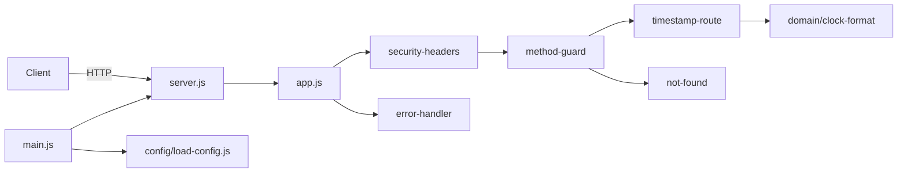

# Architecture

## Overview

`cd` is a single stateless backend process. It has no client code, so no frontend/backend split applies.

## Module responsibilities

| Module | Responsibility | Depends on |
| --- | --- | --- |
| `src/main.js` | Loads configuration, starts the server, handles `SIGINT` and `SIGTERM` | config, server |
| `src/server.js` | Owns the listener, timeouts, and shutdown bounded by a grace period | app |
| `src/app.js` | Composes the middleware and route; accepts injected clock and loggers | http |
| `src/config/load-config.js` | Validates `HOST` and `PORT` | nothing |
| `src/domain/clock-format.js` | Formats a `Date` | nothing |
| `src/http/middleware/` | Cross-cutting HTTP policy | nothing |
| `src/http/routes/timestamp-route.js` | Builds the response | domain |

## Request flow

1. `security-headers` runs first, so every response produced by Express carries the headers, including errors. Requests rejected earlier by the Node.js HTTP parser, such as malformed requests or oversized headers, receive a bare `400` or `431` without them.
2. `method-guard` rejects anything other than `GET` and `HEAD`.
3. The wildcard route writes the timestamp and logs the response time. It bypasses conditional-request handling so a `GET` or `HEAD` cannot become a `304`.
4. `not-found` answers targets the route does not match, such as `GET *`, with a generic body.
5. `error-handler` converts failures into generic plain-text responses.

## Design decisions

- **Dependencies point inward.** The domain has no knowledge of HTTP.
- **Time and logging are injected**, which keeps tests deterministic.
- **The response body format is unchanged** from the original project.
- **No helmet or test framework dependency.** A handful of static headers and the built-in test runner keep the supply chain limited to Express.

## Recommended deployment

Run one or more instances bound to a private interface behind a reverse proxy that terminates TLS and applies rate limits. The process is stateless, so instances can scale horizontally. The optional schema in `db/schema.sql` is not wired into the application; recording requests would require a new persistence module and a database client dependency.
